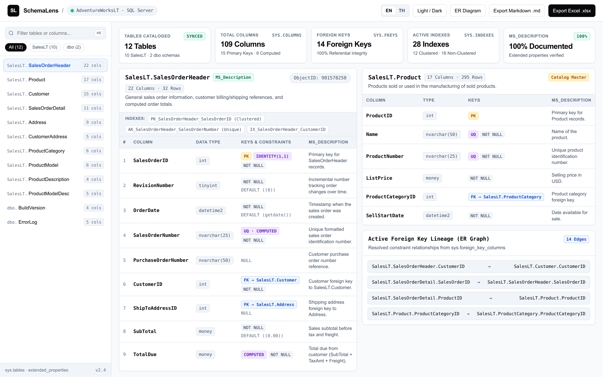

# SchemaLens — SQL Server Data Dictionary & Interactive Schema Explorer

Point **SchemaLens** at any SQL Server database and it introspects `sys.*` catalog views and `MS_Description` extended properties to generate:
1. **Interactive Web Schema Explorer (`.html`)** — A self-contained, zero-dependency interactive data catalog with instant table/column search (`⌘K`), schema filter pills, key/constraint badges (`PK`, `FK`, `UQ`, `IDENTITY`, `COMPUTED`), foreign key lineage, and Light/Dark mode.
2. **Multi-Sheet Excel Data Dictionary (`.xlsx`)** — Executive `Overview` index sheet plus one frozen-header worksheet per table with primary key highlighting.
3. **Git-Friendly Markdown Catalog (`.md`)** — Clean Markdown tables ready for engineering wikis and pull request diffs.

The repository ships with the public **AdventureWorksLT** sample database, restored automatically in Docker, so `docker compose up` produces a complete data dictionary with zero manual setup. A pre-generated workbook is also committed at [`sample-output/AdventureWorksLT-data-dictionary.xlsx`](sample-output/AdventureWorksLT-data-dictionary.xlsx).

[](https://github.com/peemphetpimolzzz/sqlserver-data-dictionary/actions/workflows/ci.yml)
[](LICENSE)



## What it captures

- **Tables & Schemas**: Grouped by schema (`SalesLT`, `dbo`, etc.) with column counts, primary key counts, and foreign key relationships.
- **Rich Column Metadata**: Ordinal position, formatted SQL data types (`nvarchar(50)`, `decimal(18,2)`, `datetime2`), nullability, primary key (`PK`), foreign key target (`FK → Schema.Table.Column`), `IDENTITY`, `COMPUTED` formulas, and default constraints.
- **100% `MS_Description` Extended Properties**: Reads both table-level (`minor_id = 0`) and column-level descriptions directly from `sys.extended_properties`.

## Quick start

> Prerequisites: **Docker and git only.**

```bash
git clone https://github.com/peemphetpimolzzz/sqlserver-data-dictionary.git
cd sqlserver-data-dictionary
cp .env.example .env
docker compose up --build
```

When it finishes, the dictionary is written to `output/AdventureWorksLT-data-dictionary.xlsx`.

### Point it at your own database

```bash
# Excel workbook (.xlsx)
docker compose run --rm generator \
  node dist/index.js --host my-server --database MyDb --user sa --password '***' \
  --output /app/output/MyDb.xlsx

# Interactive Web Catalog (.html)
docker compose run --rm generator \
  node dist/index.js --format html --output /app/output/MyDb.html

# Markdown Documentation (.md)
docker compose run --rm generator \
  node dist/index.js --format markdown --output /app/output/MyDb.md
```

## Configuration

| Flag | Env | Default |
|------|-----|---------|
| `--host` | `DB_HOST` | `localhost` |
| `--port` | `DB_PORT` | `1433` |
| `--user` | `DB_USER` | `sa` |
| `--password` | `DB_PASSWORD` | — |
| `--database` | `DB_NAME` | `AdventureWorksLT` |
| `--output` | `OUTPUT_PATH` | `output/data-dictionary.xlsx` |
| `--format` | `OUTPUT_FORMAT` | `excel` (`excel` \| `markdown` \| `html`) |

## Deploy to Azure

Because it is a batch introspection tool, it runs in the cloud as an **Azure Container Apps Job** (manual or scheduled trigger) rather than an always-on service. Infrastructure is defined as Bicep in [`infra/`](infra/): the job reads an **Azure SQL Database** and writes the generated dictionary to an **Azure Files** share. The [`Deploy (Azure)`](.github/workflows/deploy.yml) workflow builds the image in ACR and attaches it to the job using **OIDC federated credentials**, while the SQL password lives in **Azure Key Vault**.

See [`docs/deployment.md`](docs/deployment.md) for the full walkthrough.

## How it works

```
docker compose up
  └─ sqlserver  : custom image restores AdventureWorksLT from a baked-in .bak, then reports
                  healthy only once the database is online
  └─ generator  : waits for healthy, queries sys.* catalog views, builds the model, renders Excel/HTML/Markdown
```

The schema introspection lives in `src/db/introspect.ts`; the pure rows→model transform in `src/model/mapper.ts`; and the output renderers in `src/output/excel.ts`, `src/output/html.ts`, and `src/output/markdown.ts`.

## Tests

```bash
# Unit tests (pure mapping + Excel/HTML/Markdown rendering, no database needed)
npm run test:unit

# Integration test (against the dockerized AdventureWorksLT database)
docker compose up -d --build sqlserver
docker compose run --rm generator npm run test:integration
```

Both suites run automatically on every push via GitHub Actions.

## License

[MIT](LICENSE) — Part of [Peem Phetpimol's portfolio](https://peemphetpimolzzz.github.io) (Fullstack & Cloud Engineer · Test Automation).
